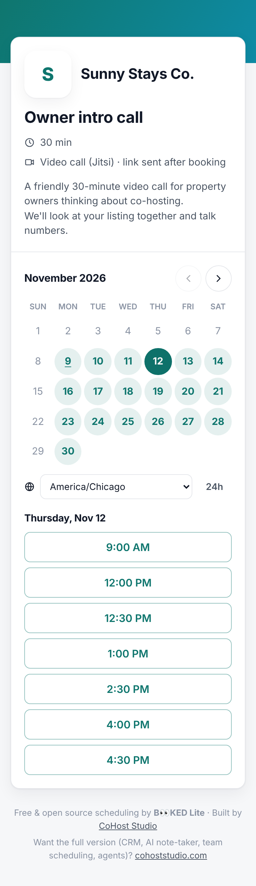
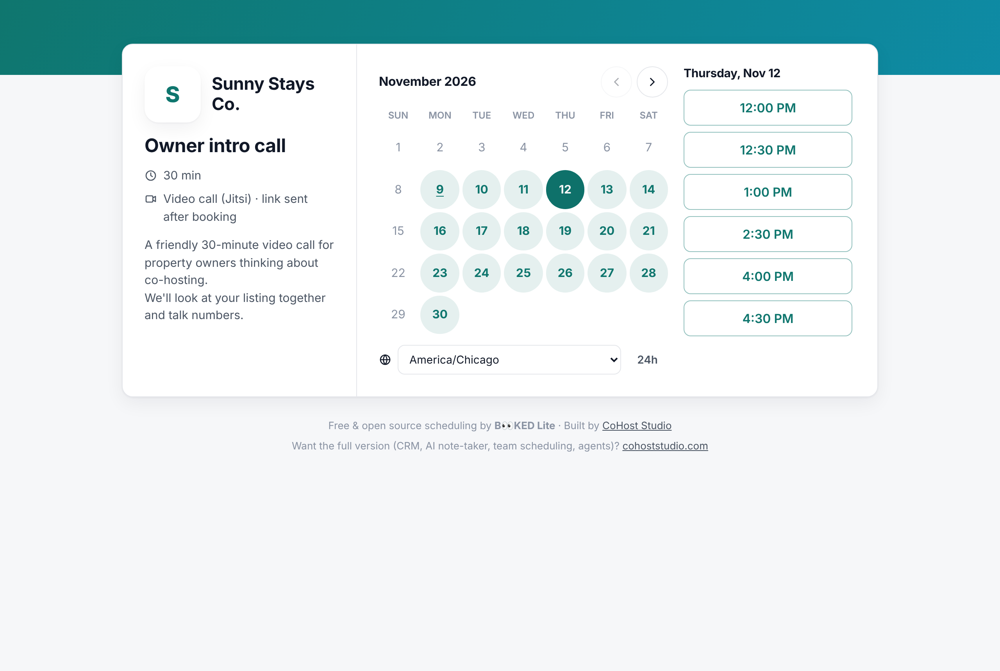
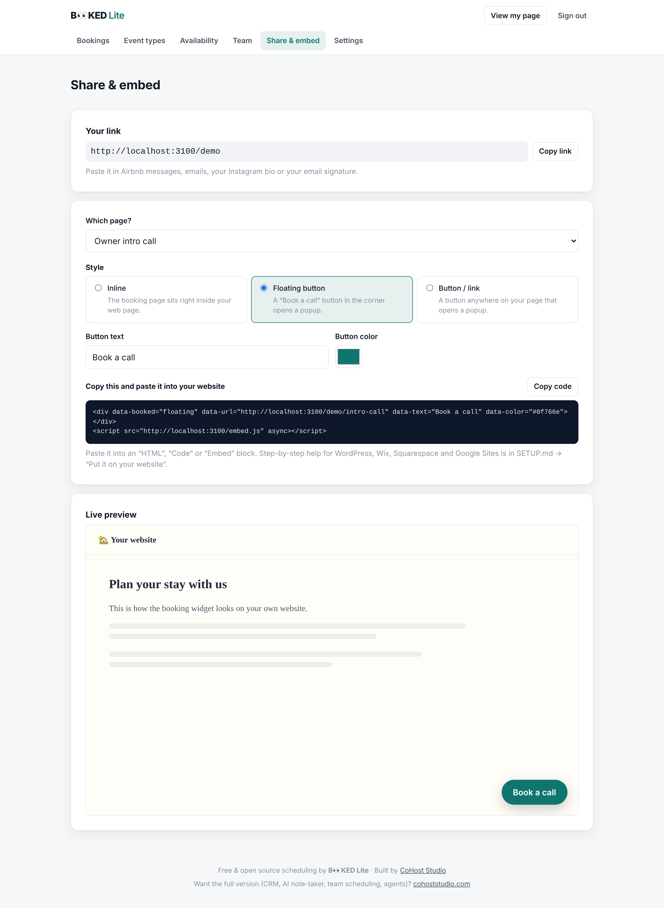

# B👀KED Lite

**A free, open-source booking page for short-term-rental hosts.** A simple Calendly alternative you own.

Guests, owners, cleaners and partners pick a time that works. It checks your Google Calendar, puts the booking
on it, emails everyone a calendar invite, sends reminders, and creates a video link automatically.

**Built by [CoHost Studio](https://cohoststudio.com).**
Want the full version (CRM, AI note-taker, team scheduling, agents)? → **[cohoststudio.com](https://cohoststudio.com)**

| Booking page (phone) | Booking page (desktop) | Embed on your website |
|---|---|---|
|  |  |  |

## ✨ Features

- **Booking pages per event type:** title, description, length, buffers before/after, minimum notice, daily limit,
  how far ahead people can book, and your own questions.
- **Fast, phone-friendly public page** at `your-site.com/your-name/event-name`.
- **Availability** = weekly hours + date overrides (holidays, turnover days), minus busy time from your **Google Calendar**
  (pick which calendars count, e.g. your synced Airbnb calendar). Bookings are written back to your calendar.
- **Timezones handled**: guests see times in their own timezone; daylight saving is handled.
- **Emails** (via Resend's free tier): confirmation with `.ics` invite, reschedule and cancel links, host notifications,
  reminders.
- **Video link per event:** a private free **Jitsi** room for every booking (default, no account needed), or an
  auto-created **Zoom** meeting with passcode (optional; connect your Zoom), or a **Google Meet** link (through your
  connected Google Calendar), or a fixed Zoom/StreamYard link, or phone, or in person. Meetings move when guests reschedule
  and are deleted when they cancel.
- **Embed it on your website:** copy-paste one snippet from the admin: inline calendar, floating "Book a call" button, or
  a popup button, in your colors. Works with WordPress, Wix, Squarespace, Google Sites and more.
- **Simple teams:** invite teammates by email; each gets their own page and connects their own calendar. Team events can go to
  the **next available person** (round robin) or need **everyone free**.
- **Simple admin:** magic-link sign-in (no passwords); edit event types, availability and branding (logo, color,
  cover photo); see and cancel bookings.

## 🚀 Set it up (no coding needed)

1. Open this repository in **[Claude Code](https://claude.com/claude-code)**.
2. Say: **"set this up for me"**.
3. Claude walks you through it step by step in plain English: free accounts, settings, going live,
   connecting your calendar, your first event, and a test booking.

Prefer to read? Everything is in **[SETUP.md](SETUP.md)**, including troubleshooting and a final checklist.

**Cost: $0.** Every service used has a free plan that's plenty for one host:

| Service | Used for | Why this one |
|---|---|---|
| [Vercel](https://vercel.com) (Hobby) | Hosting | One-click deploys from GitHub, free HTTPS |
| [Turso](https://turso.tech) | Database | Free, no servers, works the same as a local file during development |
| [Resend](https://resend.com) | Email | 3,000 free emails/month, simple setup |
| [Google Cloud](https://console.cloud.google.com) | Calendar access | Free |
| [meet.jit.si](https://meet.jit.si) | Video calls (default) | Free, no account needed for guests |
| [Zoom](https://marketplace.zoom.us) *(optional)* | Auto-created Zoom meetings | Each host connects their own Zoom |

## 🧑‍💻 For developers

```bash
npm install
cp .env.example .env      # then set ALLOWED_EMAILS=demo@example.com and CALENDAR_PROVIDER=fake
npm run db:seed           # demo host at http://localhost:3000/demo
npm run dev
```

No accounts are needed locally: the database is a file in `.data/`, emails print to the terminal (and the sign-in
page shows your login link), and `CALENDAR_PROVIDER=fake` gives you a test calendar.

```bash
npm run lint && npm run typecheck && npm test   # unit tests (Vitest)
npm run test:e2e                                # Playwright booking flow with a fake calendar
```

Stack: Next.js 16 · React 19 · TypeScript · Drizzle ORM + libSQL/Turso · Luxon · Zod. No CSS framework:
rebrand everything from the variables at the top of [`src/app/globals.css`](src/app/globals.css).
See [CLAUDE.md](CLAUDE.md) for a map of the code.

## License

[MIT](LICENSE). Free to use, change and share. If you share your version, we'd love it if you kept the
"Built by CoHost Studio" credit.
